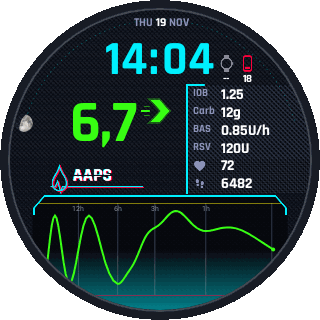
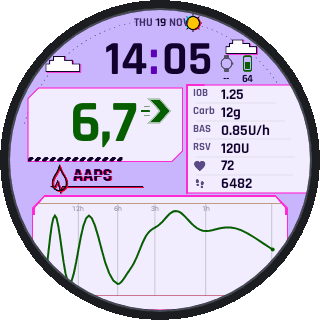
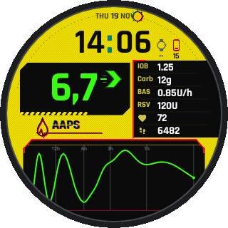
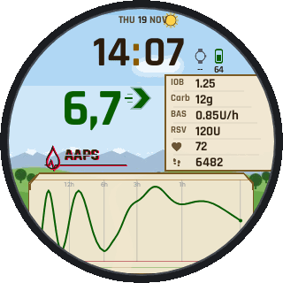
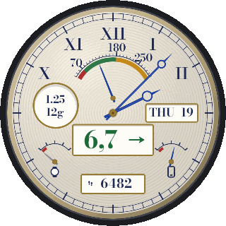
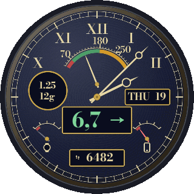
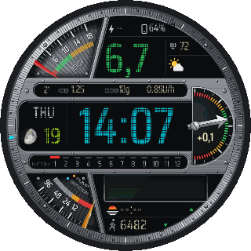

# AAPS watch faces

Custom watch face (CWF) designs for the AAPS watch app. Each design is a zip that you load in AAPS
(Wear → watch face). The finished zips are in `cwf-designs/`.

Most of them need the AAPS fork [aseesing/AndroidAPS](https://github.com/aseesing/AndroidAPS)
(branch `local/personal`): its watch app plays the wake-up animations and knows the extra values.
The keys a design can use for them (layers, formulas, templates, looks) are in
[the manual of the layer engine](https://htmlpreview.github.io/?https://github.com/aseesing/AndroidAPS/blob/local/personal/docs/watchface-animation.html),
with a live picture for every example.
`Aurora_Town_mmol_AAPS4.zip` and `Aurora_Town_mgdl_AAPS4.zip` are made for plain AAPS 4.0.0 (glucose in mmol/L or mg/dL).
`Grand_Complication_Day_AAPS4.zip` and `Grand_Complication_Night_AAPS4.zip` are made for plain AAPS 4.0.0 too.

Grand Complication (all four zips) uses only normal AAPS settings. The disc on the left shows
"Complication 1" when it is on in the settings of the watch face (any data source you pick there),
or else IOB and COB with "Show IOB" and "Show COB" (watch: AAPS, Settings, Display). The glucose
scale follows the units of the phone (mmol/L or mg/dL). With all of them off, the animated
zips show the sky with the sun and the moon in the disc; the `_AAPS4` zips show no disc at all.

| | | |
|:-:|:-:|:-:|
|  |  |  |
|  |  |  |
| |  | |

The designs are not drawn by hand. A test builds each one with the real watch face code of AAPS: it
draws the face, checks it (no text cut off, everything on the round screen, ...) and writes the zip.

## It needs AAPS

This project builds against an AAPS checkout. It includes AAPS as a Gradle composite build and uses
the module `:wear:cwfrender` (the watch face code, built for the phone).

Where AAPS lies is `aapsDir`:

- `gradle.properties` has the default: `../AndroidAPS` (a checkout beside this folder);
- `local.properties` (not in git) can set your own path, and it wins: `aapsDir=/path/to/AndroidAPS`;
- or on the command line: `./gradlew -PaapsDir=/path/to/AndroidAPS ...`.

`local.properties` also needs `sdk.dir`, the Android SDK, as in AAPS.

The AAPS checkout must have the watch face code these designs use (the `local/personal` branch, not
plain upstream AAPS). When AAPS is included in this build, it leaves out its `:app` project: the app
stops a build when its folder has uncommitted changes, and the app is not needed here.

## Build a design

Run all design tests (this checks every design and writes every zip):

```
./gradlew testDebugUnitTest
```

That takes about a minute on a Mac with 12 cores. The tests run in one test JVM per core but one, as
many as fit in the memory (3 GB each). The long design test classes run in parts, so the parts run
side by side: `CwfD2DesignTestPart1` and so on are the other parts of `CwfD2DesignTest` (see
`PartRunner.kt`). With `--tests` a class runs whole and its other parts run nothing.

When you change a design, build only that one; the name is part of the test class name, more than
one with commas:

```
./gradlew testDebugUnitTest -Pdesigns=AuroraTown
./gradlew testDebugUnitTest -Pdesigns=AuroraTown,D2
```

Keep the Gradle daemon on (do not add `--no-daemon`): it saves the start-up time of every build. When
AAPS is included in this build, it only adds the 6 modules the designs need (see
`watchfaces.settings.gradle` in AAPS).

Each test writes its zip and preview pictures to `build/cwf-design/`. It also checks that the zip kept
in `cwf-designs/` is the same design. To change a design: change its test, run it, and copy
`build/cwf-design/<name>.zip` over the one in `cwf-designs/`.

A zip must stay below about 320 KB, or the phone cannot send it to the watch.

## Files

- `src/test/kotlin/` - the design tests (`Cwf*DesignTest`) and their shared code (`*DesignBase`).
- `cwf-designs/` - the finished zips, and `fonts/` with the fonts the designs bring (each with its
  licence, SIL Open Font License).
- `xmas-bg/` - the source photos of the Aurora Town design.
- `docs/font-subset.md` - how to make a font file smaller before a design uses it.

- `images/` - the animated pictures at the top, also shown by the README of the AAPS fork. They are made by
  `ReadmeAnimationsTest`, which writes them here:

```
CWF_README_GIFS=1 ./gradlew testDebugUnitTest --tests "*ReadmeAnimationsTest*"
```
