# BG Reactor

A neon reactor for AAPS on a round Wear OS watch. The whole face takes the colour of your glucose,
and when you raise your wrist it moves the way your glucose goes.

  

Zip: [`cwf-designs/BG_Reactor.zip`](../cwf-designs/BG_Reactor.zip). It needs the watch app of the AAPS
fork [aseesing/AndroidAPS](https://github.com/aseesing/AndroidAPS) (branch `local/personal`). Plain
AAPS has no layers, looks or face options, so most of this face would be missing there.

## Colour

The colour fades smoothly through the range, with no fixed set of colours:

| Glucose | Colour |
|---|---|
| at or below your low | red |
| low end of range | green |
| your perfect range | blue |
| high end of range | green, then yellow |
| at or above your high | orange |
| no reading, or older than 12 minutes | grey |

Everything follows it: the rings, the bezel ticks, the core, the digits, the hands, the octagon
pods and the IOB/COB bars. Three options of the face set where the colours sit (see
[Options](#options)), so they do not depend on the alarm levels of AAPS.

| | | |
|:-:|:-:|:-:|
| 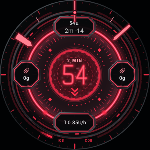 | 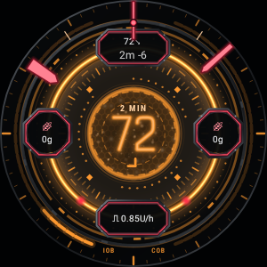 | 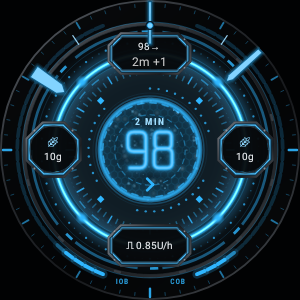 |
| 54, falling fast | 72, falling | 98, level |
| 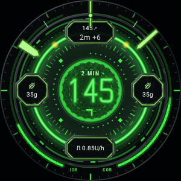 | 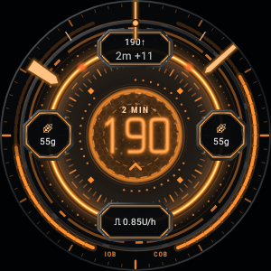 | 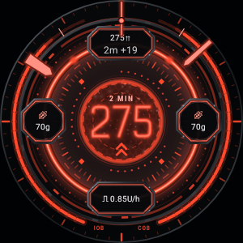 |
| 145, rising slowly | 190, rising | 275, rising fast |
| 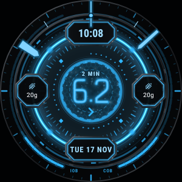 | 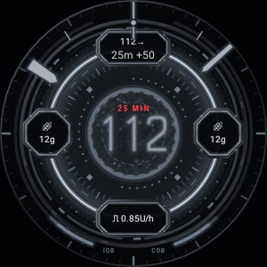 | |
| 6.2 mmol/L, time and date in the pods | a reading of 25 minutes ago | |

## Movement

When you raise your wrist the face plays a six-second wake-up animation. During the wake:
- Rising: the light climbs both sides of the rings.
- Falling: the light runs down.
- Level: the light circles.
- Slow, normal and fast trends move faster in steps.

The moving lights fade towards the colour your glucose will have in 15 minutes, from the
average change. The core behind the number is the reactor: plasma that breathes, rings that turn,
sparks that swirl and climb or sink with the trend, and cells that flicker. The glow of the digits
beats with your level: slowly in the blue range, fast at or past red or orange.

| | | |
|:-:|:-:|:-:|
| 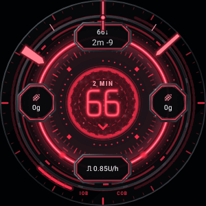 | 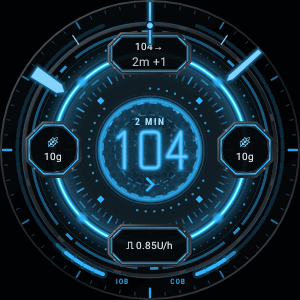 | 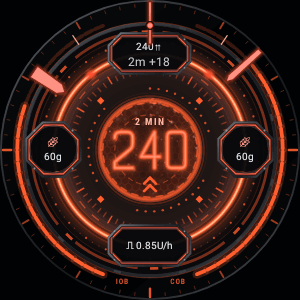 |
| 66, falling | 104, level | 240, rising fast |

When the face stands still, the trend arrow shows under the number. The arrow is hidden while the face moves.

## What is on the face

- **The glucose** in neon digits, mg/dL or mmol/L as on the phone, with how old the reading is
  above it.
- **Hands** for hours, minutes and seconds, outside the neon ring.
- **IOB bar** (left) and **COB bar** (right) in the groove of the hands. COB is shown as the insulin it
  needs (COB ÷ carb ratio), so the same height means the same effect on the glucose. A bar is
  straight up to 90 % at your usual maximum (a small tick), then grows ever slower and never quite
  fills.
- **Four octagon pods** for complications: left, right, bottom and top. Each pod shows only while its
  complication is turned on. The top and bottom pod can show the date or the time instead.

## Options

Set them on the watch or in the AAPS app (watch face settings).

| Option | Choices | Default |
|---|---|---|
| Red at or below | 55, 60, 65, 70 mg/dL | 70 |
| Blue (perfect) range | 80–140, 90–150, 80–120, 100–140 mg/dL | 80–140 |
| Orange at or above | 160, 180, 200, 220, 250 mg/dL | 180 |
| Top and bottom pod | complications, or the date or the time in the top and/or bottom pod | complications |
| Insulin at 90 % of the IOB/COB bars | Max IOB from AAPS, or 2–15 U | Max IOB from AAPS |
| Carb ratio for the COB bar | from the AAPS profile, or 5–30 g/U | from the AAPS profile |

The bars read the Max IOB setting and the carb ratio of the running profile from AAPS, so they
follow profile switches and the time of day. Without these values (an older AAPS) they use 6 U and
10 g/U.

## Limits

- On the always-on screen the face shows the hands and the complications only, without the
  glucose.
- The resting face is a still picture; the movement plays during the wake.
- There is no Watch Face Format (WFF) version yet.
- These pictures are drawn by the watch's own face code on a computer (the face editor), not taken
  from a watch.
